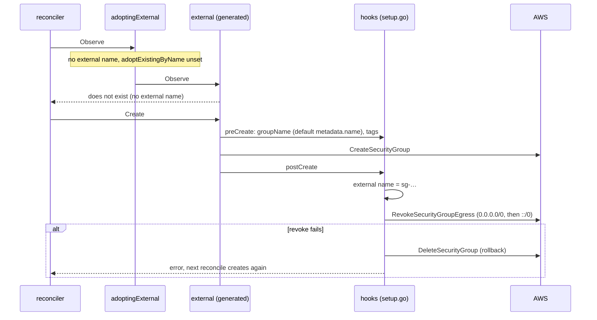
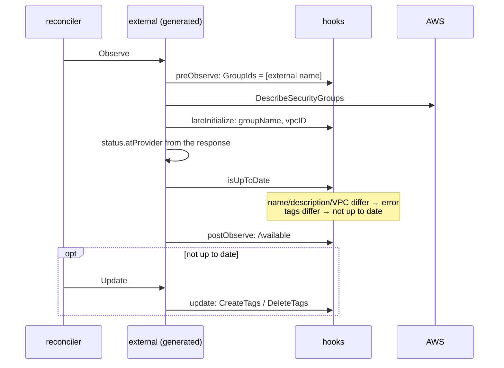
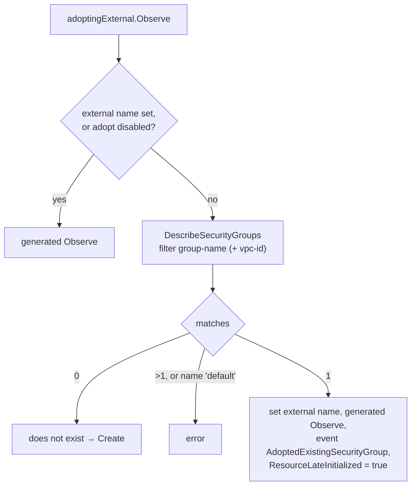

# Anatomy of a kind: ec2 SecurityGroup

This page follows one kind through its code, so that you can read, review
or change any kind without knowing its history. The example is
`SecurityGroup` (`internal/controller/ec2/securitygroup`): it is small, but
it uses most extension points, including the unusual ones (no update API,
AWS-assigned IDs, a wrapped client).

Background: [architecture.md](architecture.md) (big picture),
[code-generator.md](components/code-generator.md) (hooks, drift detection),
[crossplane-runtime.md](components/crossplane-runtime.md) (one reconcile).

## Read the files in this order

| # | File | What to look for |
|---|------|------------------|
| 1 | `internal/controller/ec2/securitygroup/README.md` | What the kind does and doesn't do, its limitations, history |
| 2 | `apis/ec2/generator-config.yaml` | Which AWS operations and fields became the kind (ignores, renames) |
| 3 | `apis/ec2/v1alpha1/zz_security_group.go` | The API: `SecurityGroupParameters` (spec) and `SecurityGroupObservation` (status) |
| 4 | `apis/ec2/v1alpha1/custom_types.go` | Hand-written spec fields (`adoptExistingByName`, references of the rule kinds) |
| 5 | `internal/controller/ec2/securitygroup/zz_controller.go` | The verbs `Observe`/`Create`/`Update`/`Delete` and where they call hooks |
| 6 | `internal/controller/ec2/securitygroup/setup.go` | The hooks: everything that is specific to this kind |
| 7 | `internal/controller/ec2/securitygroup/setup_test.go` | The behavior, as table tests |

Only 4, 6 and 7 (and the README) are hand-written. Read
`zz_controller.go` once per kind: it's short and tells you exactly which
hook runs when.

## The life of a SecurityGroup

### First reconcile: create

Why each step:

- **The external name is the AWS ID** (`sg-…`), known only after
  `CreateSecurityGroup`. So `postCreate` sets it, and the default
  initializer, which would set `metadata.name`, is disabled
  (`managed.WithInitializers()` in `configureSecurityGroup`).
- **Default egress is revoked** because AWS adds an allow-all egress rule to
  every new group. Egress should be what `SecurityGroupEgressRule`
  resources allow ([ADR 0009](adr/0009-ec2-security-group-model.md)).
  Right after creation AWS may not know the group yet, so the revoke is
  retried on `InvalidGroup.NotFound` (`revokeBackoff`). A missing rule
  (`InvalidPermission.NotFound`, e.g. no IPv6 in the VPC) is fine.
- **Rollback on failure**: once Create returned, the reconciler never
  calls it again for this group, so nothing would retry the revoke. Deleting
  the group makes the next reconcile start over cleanly.

### Every later reconcile: observe, maybe update

- **Lookup by ID, not by name**: the generated input would use the name.
  `preObserve` sets `GroupIds` so a renamed or recreated group isn't
  confused with ours.
- **Immutable fields are errors, not drift**: AWS can't change a group's
  name, description or VPC. If `isUpToDate` returned "not up to date", the
  reconciler would call Update forever. An error stops the reconcile with a
  clear message (`Synced=False`) until the spec is fixed or the resource is
  recreated.
- **Tags**: desired = spec tags + Crossplane's `crossplane-*` tags
  (`svcutils.DesiredTags`); `aws:` tags are ignored. The status shows the
  tags read *before* the update, so they lag one poll behind.
- **No generated update**: EC2 has no "modify security group" operation, so
  the generator renders `Update` as a single `update` hook (default: do
  nothing) and `isUpToDate` defaults to "always up to date". Both are set
  by hand here. Kinds with an update operation get
  `preUpdate` → SDK call → `postUpdate` and the generated
  `DiffUpdatableParameters` instead.

### Delete

`preDelete` deletes by ID (the generated input would send the name too).
While network interfaces or rules of other groups use the group, AWS
returns `DependencyViolation`; `postDelete` turns it into a clear message,
and the reconciler retries until the users are gone.

To keep the AWS group when the resource is deleted, leave `Delete` out of
`spec.managementPolicies` (namespaced resources have no `deletionPolicy`).

## Adoption: wrapping the generated client

`adoptExistingByName` doesn't fit a hook: it has to run *before* the
generated `Observe` and change the external name. So `setup.go` wraps the
generated client (`wrapExternal`) and overrides only `Observe`:

- **An existing external name always wins**: adoption only fills an empty
  one.
- **`ResourceLateInitialized = true`** makes the reconciler save the object,
  so the external name found is persisted.
- **The event** needs the manager's event recorder, which only `configure`
  receives. So `configure` replaces `wrapExternal` with one that has the
  recorder (`adoptingWrapper`); `init` sets one with a no-op recorder so
  tests work without a manager.

The risks of adoption (two resources managing one group) are in the kind
README.

## The rule kinds in comparison

`SecurityGroupIngressRule` and `SecurityGroupEgressRule` follow the same
pattern; the egress `setup.go` is a copy of the ingress one with the egress
operations. Differences from `SecurityGroup`:

| | SecurityGroup | Rule kinds |
|---|---|---|
| External name | `sg-…` from `CreateSecurityGroup` | `sgr-…` from `AuthorizeSecurityGroup{Ingress,Egress}` |
| Update | `update` hook, tags only | `ModifySecurityGroupRules` (keeps the rule ID) + tags in `postUpdate` |
| Drift | tags; immutable fields are errors | `svcutils.Rule.Diff`: protocol, ports, source, description, tags; another group, direction or source type is an error |
| Validation | — | `Rule.Validate` in `preCreate`/`preUpdate`: group and protocol set, exactly one source |
| References | — | `securityGroupIDRef`, `referencedSecurityGroupIDRef` (custom fields) |

Shared code is in `internal/controller/ec2/utils`: `rule.go` (normalizing
protocols (`6` → `tcp`, case), ports `-1`, building `IpPermission`), `tags.go`,
`errors.go` (AWS error codes).

## Tests

`setup_test.go` drives the real generated client with a fake SDK
(`internal/clients/ec2/fake`, which records calls in `Calls`), so each test
covers generated and hand-written code together. Look there first when you
change behavior: one table case per rule in this page. See
[testing.md](components/testing.md).

## Changing a kind: where does it go?

| Change | Where |
|--------|-------|
| Expose or hide an AWS field | `apis/<svc>/generator-config.yaml`, then `make services && make generate` |
| A field AWS doesn't have (option, reference) | `apis/<svc>/v1alpha1/custom_types.go`, then `make generate` |
| Different request or response handling | a `pre*`/`post*` hook in `setup.go` |
| What counts as drift | `isUpToDate` in `setup.go`, starting from `DiffUpdatableParameters` if generated |
| Behavior before/around a whole verb | `wrapExternal` (like adoption above) |
| A hook that doesn't exist | `codegen/templates/controller/controller.go.tpl`, regenerate all |
| Any behavior change | the kind README (behavior, history), `CHANGELOG.md`, a test case |
