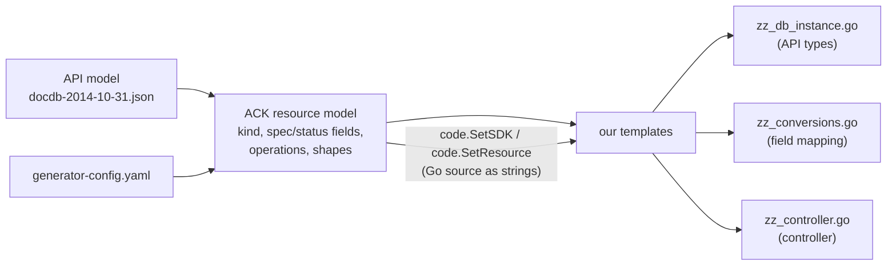

# ACK code-generator

## What it is

[aws-controllers-k8s/code-generator](https://github.com/aws-controllers-k8s/code-generator)
is the generator behind the AWS Controllers for Kubernetes (ACK) project.
It reads an AWS API model plus a `generator-config.yaml` and builds a
**model of Kubernetes resources**: which kinds exist, which operations
create/read/update/delete them, which fields go to spec and status, and Go
snippets that copy fields between the Kubernetes object and SDK
inputs/outputs. ACK uses it with its own templates and its own runtime.

## Why

- Inferring kinds, operations and field mappings from AWS models is the hard
  part of a generator, and ACK has solved it for hundreds of services.
- provider-aws (v1) was generated with the same tool, so its
  `generator-config.yaml` files can be reused unchanged
  ([ADR 0003](../adr/0003-ack-code-generator-as-a-library.md)).
- Recent versions emit **AWS SDK v2** code.

## What we use and what we don't

| Used | Not used |
|------|----------|
| Model loading (`pkg/sdk`, `pkg/api`) | ACK runtime (`aws-controllers-k8s/runtime`) |
| | ACK's Crossplane target (`ack-generate crossplane`): runtime v1, SDK v1, cluster-scoped; our templates replace it |
| `generator-config.yaml` format (`pkg/config`) | ACK templates, Helm charts, RBAC, release artifacts |
| CRD model: kinds, spec/status fields, operations (`pkg/model`) | ACK metadata/status fields (`IncludeACKMetadata: false`) |
| Code snippets `code.SetSDK`, `code.SetResource`, … (`pkg/generate/code`) | ACK's `compare` delta code (we generate our own diff) |
| Template set rendering (`pkg/generate/templateset`) | |

It is a library dependency of the separate `codegen/` Go module only
(`codegen/go.mod`, currently v0.64.0); the provider binary doesn't depend on
it.

## How it is used

`codegen/internal/generator/generator.go`:

1. `ackgenconfig.New(generator-config.yaml, defaultConfig)`. `defaultConfig`
   points ACK's snippets at Crossplane's layout:
   `.Spec.ForProvider` / `.Status.AtProvider`.
2. Small adaptations before loading the model: legacy operation types of
   provider-aws configs (`read` → `READ_ONE`), unexported SDK members added
   to `ignore.field_paths`.
3. `ackmodel.New(…)` → `m.GetCRDs()`, `GetTypeDefs()`, `GetEnumDefs()`.
4. Our templates call ACK snippet functions through the `funcMap`
   (`GoCodeSetCreateInput`, `GoCodeSetReadOneOutput`, …).
5. Post-processing: unkeyed `metav1.Time{…}` literals are keyed, then
   `goimports`.

## Worked example: docdb DBInstance

"Field-mapping code" is the Go code that copies values field by field
between the Kubernetes object (`cr.Spec.ForProvider`, `cr.Status.AtProvider`)
and the SDK input/output structs. Every API call of a controller needs it,
and it is the part ACK writes for us.



**1. ACK builds the resource model** (`ackmodel.New`, `GetCRDs`):

- Kinds: `CreateDBInstance` → kind `DBInstance`. Operations are matched by
  name: `DescribeDBInstances` (read), `ModifyDBInstance` (update),
  `DeleteDBInstance` (delete).
- Spec fields: the members of the create input, minus `ignore.field_paths`,
  plus fields added with `from:`.
- Status fields: members of the create/read output that are not spec fields
  (`Endpoint`, `BackupRetentionPeriod`, …).
- Names and types: `PerformanceInsightsKMSKeyId` → `PerformanceInsightsKMSKeyID`,
  integer → `*int64`, list of strings → `[]*string`, timestamp →
  `metav1.Time`, structures → API types such as `CertificateDetails`.

Nothing is written yet; this is an in-memory model.

**2. Templates render the files and ask ACK for snippets.** The API types
come from the model (`apis/docdb/v1alpha1/zz_db_instance.go`):

```go
DBInstanceClass *string `json:"dbInstanceClass"`
PromotionTier   *int64  `json:"promotionTier,omitempty"`
```

A template line such as `{{ GoCodeSetCreateInput .CRD "cr" "res" 1 }}`
calls `code.SetSDK`, which returns the body of `GenerateCreateDBInstanceInput`
(Kubernetes object → SDK input):

```go
if cr.Spec.ForProvider.PerformanceInsightsKMSKeyID != nil {   // renamed field
    res.PerformanceInsightsKMSKeyId = cr.Spec.ForProvider.PerformanceInsightsKMSKeyID
}
if cr.Spec.ForProvider.PromotionTier != nil {                 // *int64 → *int32
    promotionTierCopy0 := *cr.Spec.ForProvider.PromotionTier
    if promotionTierCopy0 > math.MaxInt32 || promotionTierCopy0 < math.MinInt32 {
        return nil, fmt.Errorf("error: field PromotionTier is of type int32")
    }
    promotionTierCopy := int32(promotionTierCopy0)
    res.PromotionTier = &promotionTierCopy
}
```

`code.SetResource` returns the body of `GenerateDBInstance` (SDK output →
Kubernetes object), including unwrapping the list of `DescribeDBInstances`
and splitting fields between spec and status:

```go
for _, elem := range resp.DBInstances {
    if elem.CACertificateIdentifier != nil {                      // spec field
        cr.Spec.ForProvider.CACertificateIdentifier = elem.CACertificateIdentifier
    }
    if elem.CertificateDetails != nil {                           // nested struct, status
        f4 := &svcapitypes.CertificateDetails{}
        if elem.CertificateDetails.ValidTill != nil {
            f4.ValidTill = &metav1.Time{Time: *elem.CertificateDetails.ValidTill}
        }
        cr.Status.AtProvider.CertificateDetails = f4
    }
    …
```

The snippets handle renames, `int64`/`int32`, pointer vs value slices,
nested structs, lists of structs, maps, enums, timestamps and list/wrapper
outputs — for every field of every operation.

**3. Our templates add everything around the snippets:**

| Generated function | Body from ACK | From our templates |
|--------------------|---------------|--------------------|
| `GenerateCreate…Input`, `GenerateModify…Input`, `GenerateDelete…Input` | `code.SetSDK` | signature, error return |
| `Generate<Kind>` (read output → object) | `code.SetResource` | signature |
| `DiffUpdatableParameters` | — | everything ([code-generator.md](code-generator.md)) |
| `zz_controller.go` | operation and shape names only | everything (crossplane-runtime v2, hooks, `Client`) |

In short: ACK decides what the resource looks like and how its fields map
to the SDK; our templates decide how the controller behaves; hand-written
`setup.go` adds what neither can infer (identity, states, secrets, special
fields).

## `generator-config.yaml` essentials

The format is ACK's ([reference](https://github.com/aws-controllers-k8s/code-generator/blob/main/pkg/config/config.go)).
Settings used most here:

```yaml
ignore:
  resource_names: [GlobalCluster]       # kinds not to generate
  field_paths:                          # members not to map
    - CreateDBClusterInput.DBClusterIdentifier   # external name instead
    - CreateDBClusterInput.MasterUserPassword    # secret ref instead
operations:
  DescribeDBClusters:
    operation_type: [READ_MANY]         # override inferred operation types
    resource_name: DBCluster
resources:
  DBCluster:
    fields:
      AllowMajorVersionUpgrade:         # field that only an update sends
        from: {operation: ModifyDBCluster, path: AllowMajorVersionUpgrade}
      EngineVersion:                    # observed value in status
        is_read_only: true
        from: {operation: DescribeDBClusters, path: DBClusters.EngineVersion}
    exceptions:
      errors:
        404: {code: DBClusterNotFoundFault}   # -> IsNotFound
    compare:
      ignore: [Tags]                    # excluded from DiffUpdatableParameters
```

`apis/<svc>/generator-config.yaml` of an imported service is written by the
importer (source config + all other kinds ignored); edit it like any other
config afterwards.

## Pitfalls

- **Operation inference** is name based (`Create<Kind>`, `Describe<Kind>s`,
  …). Irregular APIs need `operations:` overrides.
- **Renames** (`renames.operations`) change the spec field name, not the SDK
  name; hand-written code must use the spec name.
- **ReadMany vs ReadOne**: with `Describe…s` (ReadMany) the generated
  observe gets a list and calls `filterList`; most AWS "describe" calls are
  ReadMany.
- ACK snippets are SDK-v2 code, but types in the API stay ACK-style
  (`*int64`, `[]*string`); see [aws-sdk.md](aws-sdk.md#types-api-vs-sdk).
