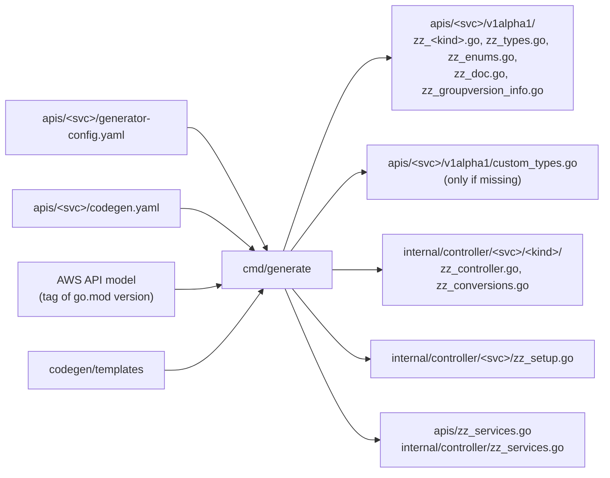
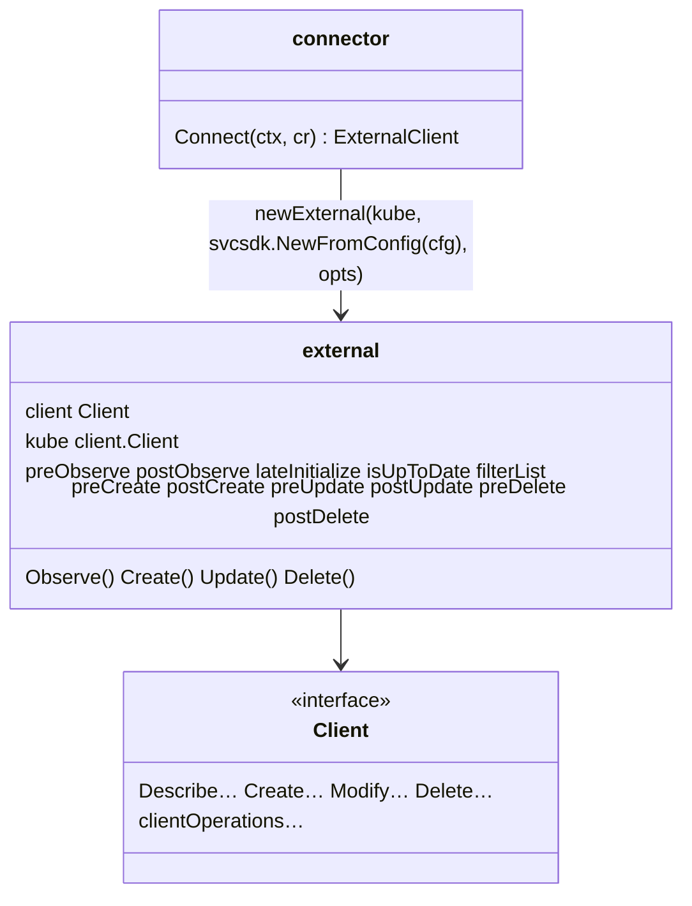
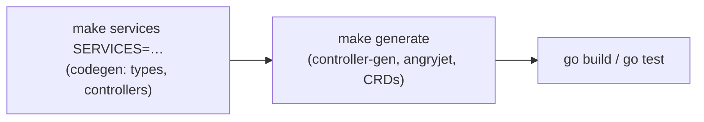

# Code generator (`codegen/cmd/generate`)

## What it is

Our generator: it loads a service with the
[ACK code-generator](ack-code-generator.md) and renders **our own templates**
(`codegen/templates`) for crossplane-runtime v2, namespaced managed
resources and AWS SDK v2. It lives in the separate Go module `codegen/`, so
its dependencies (ACK, the SDK v1 model loader) never reach the provider.

## Why

ACK's templates target the ACK runtime. Crossplane needs different types
(`spec.forProvider`, `status.atProvider`, `ManagedResourceSpec`), a
different controller (`managed.ExternalClient`) and extension points for
hand-written code. Owning the templates keeps that under our control while
ACK does the model work ([ADR 0003](../adr/0003-ack-code-generator-as-a-library.md)).

## Inputs and outputs



| Template | Output |
|----------|--------|
| `apis/crd.go.tpl` | `zz_<kind>.go`: `<Kind>Parameters` (embeds `Custom<Kind>Parameters`), `<Kind>Observation`, spec/status, kubebuilder markers |
| `apis/types.go.tpl`, `enums.go.tpl` | shared structs and enums of the service |
| `apis/doc.go.tpl`, `groupversion_info.go.tpl` | package doc, `<svc>.aws2.crossplane.io` group registration |
| `controller/controller.go.tpl` | `Setup`/`SetupGated`, `Client` interface, connector, `external` with hooks |
| `controller/conversions.go.tpl` | `Generate<Op>Input`, `Generate<Kind>`, `DiffUpdatableParameters`, `IsNotFound` |
| `controller/setup.go.tpl` | `SetupGated` of the service |

`apis/<svc>/codegen.yaml` holds what ACK's config can't express. It is
parsed strictly: an unknown key is an error, and every key under `kinds`
must be a generated kind.

```yaml
clientOperations:          # extra SDK operations in the Client interface
  DBCluster:
    - RestoreDBClusterFromSnapshot
    - ListTagsForResource
kinds:                     # per-kind settings, all optional
  Widget:
    identifier: WidgetName          # read output member that equals the external name
    identifierInput: WidgetNames    # read input member, if not identifier or identifier+"s"
    customObserve: true             # no read operation: a hand-written observe hook is required
    customDelete: true              # no delete operation: a hand-written delete hook is required
    orphanOnDelete: true            # no delete operation: deleting the MR leaves the AWS resource
    customIsUpToDate: true          # GetAttributes kind with an update operation: hand-written isUpToDate
    immutableFields: [kmsKeyID]     # JSON names of spec.forProvider fields CEL keeps unchanged
    allowSensitiveFields:           # secret-looking fields that are knowingly plain
      - path: spec.forProvider.clientToken
        reason: idempotency token, not a secret
```

## Safety checks (fail closed)

`make services` stops, and writes nothing, when the generator can't emit a
safe default. It reports every problem of every kind at once, and each
message names the config line to write
([ADR 0011](../adr/0011-fail-closed-generator-defaults.md)).

| Check | Fix |
|-------|-----|
| An `ignore.field_paths` entry matches nothing in the API model (typo, renamed member, or a member below a list, which ACK can't ignore) | fix or remove the entry |
| A ReadMany kind has no member that holds the external name (`<Kind>Identifier`, `<Kind>Id`, `<Kind>Name` in both the read output element and the read input), or several match | `kinds.<Kind>.identifier` (and `identifierInput`) |
| A secret-looking string or binary field (password, secret, token, credential, passphrase, private/API/access key; not `…Arn`, `…KmsKeyId`, `…Status`, `…Id`) would be a plain spec or status field | ignore it in `ignore.field_paths` and add a `LocalSecretKeySelector` in `custom_types.go`, or `allowSensitiveFields` with a reason |
| No read operation | add one, or `customObserve` + an observe hook |
| No delete operation | `customDelete` + a delete hook, or `orphanOnDelete` |
| No "not found" (404) error code in the model or config | `resources.<Kind>.exceptions.errors.404.code` |
| A ReadMany output has several lists | `operations.<Op>.output_wrapper_field_path` |
| A GetAttributes kind can be updated (no generated drift check) | `customIsUpToDate` + an isUpToDate hook |
| An `immutableFields` entry is not a spec field | fix the entry |

Opt-ins on a kind they don't apply to are errors too, so stale settings
don't hide.

**Imported services.** `generator-config.yaml` of an imported service is
derived from `apis/<svc>/import.yaml`. Put `ignore.field_paths` additions
into `import.yaml` `ignoreFieldPaths` and other keys under `generatorConfig`;
a hand edit of the derived file is lost on the next import.

## The generated controller

A worked example of one kind, hook by hook:
[Anatomy of a kind](../anatomy-of-a-kind.md).



Each verb builds the SDK input with a generated `Generate<Op>Input`, calls
the hooks around the SDK call and maps the output back:

```mermaid
sequenceDiagram
    participant R as managed reconciler
    participant E as external (zz_controller.go)
    participant H as hooks (setup.go)
    participant A as AWS
    R->>E: Observe(cr)
    E->>E: Generate<Read>Input: identifier = external name
    E->>H: preObserve(input)
    E->>A: Describe…
    E->>H: filterList(resp)  [ReadMany only; >1 match is an error]
    E->>H: lateInitialize(spec, resp)
    E->>E: Generate<Kind>(resp) → status.atProvider (Custom<Kind>Observation kept)
    E->>H: isUpToDate(cr, resp) → upToDate, diff
    E->>H: postObserve(obs)
    E-->>R: ExternalObservation
```

Create, Update and Delete follow the same pattern
(`pre<Verb>` → SDK call → `post<Verb>`). `preDelete` can return `true` to
skip the delete call (e.g. already deleting).

What the generated code guarantees:

- **Identity.** The read, update and delete inputs take the resource's
  identifier from the external name (`crossplane.io/external-name`), never
  from `status`, which is empty before the first observe. The create input
  does not: a kind whose create input needs the name sets it in `preCreate`
  (`obj.<Name> = pointer.ToOrNilIfZeroValue(meta.GetExternalName(cr))`).
  A ReadMany observe keeps only exact matches (`filterByExternalName`) and
  fails if more than one is left instead of adopting one of them. APIs that normalise
  identifiers (RDS lowercases them) need a hand-written `filterList`.
- **Spec is the user's.** Create maps the AWS response into
  `status.atProvider` only, through a scratch copy. Values AWS fills in or
  normalises reach `spec` only through `lateInitialize` on the next observe.
- **Nil responses.** A nil create response or output wrapper skips the
  mapping (AWS reported success); a nil describe response is an error, not
  "doesn't exist", because that would create a duplicate.
- **Hand-written status.** `Custom<Kind>Observation` keeps last poll's value
  until the hooks run; `postObserve` refreshes it.

### Hook defaults

| Hook | Default |
|------|---------|
| `preObserve`, `postObserve`, `lateInitialize` | no-op |
| `filterList` (ReadMany) | `filterByExternalName`: keep elements whose identifier equals the external name |
| `isUpToDate` | `isUpToDateUpdatable`; an error for a GetAttributes kind with `customIsUpToDate`; always up to date if the kind has no update operation |
| `observe` (no read operation, `customObserve`) | error "Observe is not implemented" |
| `delete` (no delete operation) | error "Delete is not implemented" (`customDelete`), or success without an AWS call (`orphanOnDelete`) |
| `preCreate`/`postCreate`, `preUpdate`/`postUpdate`, `preDelete`/`postDelete` | no-op |

**Kinds without an update operation** (e.g. ec2 `SecurityGroup`: AWS has
no "modify security group"): `Update` calls a single `update` hook (default:
do nothing) instead of `preUpdate` → SDK call → `postUpdate`, and
`isUpToDate` defaults to always up to date, since nothing could be
updated. Set both if something can change, e.g. tags via `CreateTags`.

The generated controller does **not** set the `Available` condition: that
needs knowledge of the resource's states and belongs in `postObserve`.

### Customizing: `configure` and `wrapExternal`

Hand-written code in `setup.go` sets two package variables in `init()`:

```go
func init() {
	// Hooks of the external client and extra reconciler options.
	configure = func(mgr ctrl.Manager, o controller.Options) ([]option, []managed.ReconcilerOption, error) {
		return []option{func(e *external) {
				e.postObserve = postObserve
				e.isUpToDate = isUpToDate
			}}, nil, nil // or reconciler options, e.g. a custom connector
	}
	// Optional: wrap the client to override a verb, e.g. Create for restores.
	wrapExternal = func(e *external) managed.TypedExternalClient[*svcapitypes.DBCluster] {
		return &customExternal{external: e}
	}
}
```

`configure` runs once in `Setup`, before any `Connect`; it is the only
hook that receives the manager. Code that needs the manager inside a
wrapped client (e.g. an event recorder) can set `wrapExternal` from
`configure` (ec2 `SecurityGroup`, `adoptingWrapper`).

Reconciler options from `configure` are appended after the defaults, so
they can override them (e.g. a custom connector). Logger, poll interval,
recorder, management policies, change logs and metrics are already wired by
the generated `Setup`.

If a hook you need doesn't exist, change `controller.go.tpl` and regenerate;
never edit `zz_` files.

### Immutable fields (CEL)

Every regional kind's `spec.forProvider.region` carries
`x-kubernetes-validations: self == oldSelf` ("region is immutable"):
changing it would create a new, empty resource in the other region. Fields
in `kinds.<Kind>.immutableFields`, and the identifier when it is a spec
field, get the same rule; optional ones also get a rule on the parameters
type that stops removing them once set. Unset → set stays allowed, so late
initialization still works. CEL can't see `metadata.annotations`, so the
external name itself isn't protected (that would need a webhook).

### Drift detection: `DiffUpdatableParameters`

`zz_conversions.go` contains, for kinds with an update and a read operation:

```go
func DiffUpdatableParameters(desired, observed *svcapitypes.DBClusterParameters) []string
```

It returns the JSON names of fields that differ. A field is compared if

1. the **update** operation's input has it, and
2. the **read** operation's output has it (so `Generate<Kind>` fills it), and
3. it isn't excluded by `compare.is_ignored` or `resources.<Kind>.compare.ignore`.

The field list is computed at generation time
(`codegen/internal/generator/compare.go`). Comparison uses
`internal/utils/compare.IsSubset`: unset desired fields are unmanaged,
slices are order-insensitive, structs compare only set fields. In detail
([ADR 0010](../adr/0010-compare-semantics-and-pending-overlay.md)):

- a desired struct against an observed nil compares with the zero struct,
  so `&T{}` vs nil is equal and `&T{X: 1}` vs nil differs (R5);
- slices of structs are equal when every desired element can be matched
  one-to-one to an observed element it is a subset of, in any order (R11);
- maps: every desired key must be present in observed, then values are
  compared; a nil desired value accepts any observed value (R14).

Not covered, by design, so hand-written `isUpToDate` hooks add them:

- fields named or shaped differently in the read output
  (`vpcSecurityGroupIDs` ↔ `VpcSecurityGroups[].VpcSecurityGroupId`);
- fields that aren't returned (passwords) and tags (separate API);
- semantics such as "no downgrades" or "key ID equals key ARN"
  (`compare.KMSKeyIDEqual`).

A hand-written hook builds on the generated diff:

```go
diff := compare.Without(DiffUpdatableParameters(p, &GenerateDBCluster(resp).Spec.ForProvider), "engineVersion")
if !isEngineVersionUpToDate(p, cluster) {
	diff = append(diff, "engineVersion")
}
return len(diff) == 0, compare.Message(diff), nil
```

See [ADR 0007](../adr/0007-generated-drift-detection.md).

## Generation order



Hand-written code that needs generated methods (e.g.
`var _ resource.Managed = (*DBCluster)(nil)`) compiles only after
`make generate`.

## Writing files

The generator renders and formats every file in memory first. If a
template produces code that doesn't format, it writes the source to
`<path>.broken` and leaves all outputs untouched. Otherwise it writes the
files in a fixed order, each atomically (temp file + rename), and removes
`zz_` files of kinds that are no longer generated (and their empty
directories). A removed kind whose controller directory still has
hand-written files is an error: delete the directory or stop ignoring the
kind. `zz_generated.*` files belong to `make generate`.

## Commands

```sh
make services SERVICES="rds docdb"   # regenerate services
make generate                        # deepcopy, managed methods, resolvers, CRDs
make codegen.test                    # generator and importer tests
cd codegen && go run ./cmd/generate --list-kinds --service ec2   # kinds (not ignored) and their model names
cd codegen && go run ./cmd/generate --registries-only --output ..   # after removing a service
```

## Pitfalls

- `custom_types.go` is only created if missing; after that it's yours.
- A field in `Custom<Kind>Parameters` with the same name as a generated
  field is shadowed by the generated one (Go and JSON pick the shallower
  field), so the custom field is dead. Happens when a newer model adds a
  field that provider-aws had added by hand (docdb
  `DBInstance.CACertificateIdentifier`); remove the custom one.
- Adding a `clientOperations` entry changes the `Client` interface: update
  the fakes in `internal/clients/<svc>/fake`.
- `ignore.resource_names` takes AWS model names (`Vpc`, `DhcpOptions`), not
  the kind names the generator derives (`VPC`, `DHCPOptions`). `--list-kinds`
  prints both for the kinds the config does not ignore.
- Generated fields can't carry `+crossplane:generate:reference` markers.
  For a reference, ignore the field in the generator config and add it,
  with `Ref`/`Selector`, to `Custom<Kind>Parameters` (ec2 rule kinds), or
  write `ResolveReferences` by hand.
- Generated controllers set the external name only for kinds whose name is
  an input field. If AWS assigns the ID (`sg-…`), set it in `postCreate`
  with `meta.SetExternalName` and disable the default initializer
  (`managed.WithInitializers()`), which would use `metadata.name`.
