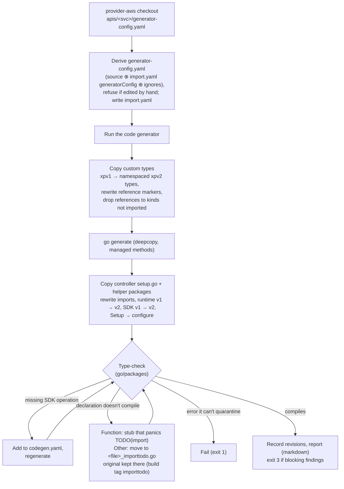

# Importer (`codegen/cmd/import`)

## What it is

A tool that ports managed-resource kinds from
[crossplane-contrib/provider-aws](https://github.com/crossplane-contrib/provider-aws)
(crossplane-runtime v1, AWS SDK v1, cluster-scoped) to this provider
(runtime v2, SDK v2, namespaced). It does the mechanical work and leaves a
compiling repository plus a list of what a human still has to port. It
fails closed: nothing it could not port is dropped silently
([ADR 0012](../adr/0012-importer-fails-closed.md)).

## Why

provider-aws contains years of hand-written behavior per kind (passwords,
restores, special drift rules). Rewriting it is slow and loses edge cases;
copying it by hand is error-prone. The importer makes porting repeatable,
and every fix to it helps the next kind
([ADR 0004](../adr/0004-import-kinds-from-provider-aws.md)).

## Flow



## Outputs

| Output | Meaning |
|--------|---------|
| `apis/<svc>/import.yaml` | Imported kinds, `ignoreFieldPaths`, the `generatorConfig` overlay, `generatorConfigSHA256`, `lastImport` and per kind the source `revisions` (repository, commit, `dirty`, `backfilled`) |
| `apis/<svc>/generator-config.yaml` | Derived, do not edit: source config, `generatorConfig` merged over it, every other kind ignored (by AWS model name, e.g. `Vpc` for kind `VPC`), `ignoreFieldPaths` added |
| `apis/<svc>/codegen.yaml` | SDK operations the ported code calls |
| `apis/<svc>/v1alpha1/custom_types.go`, … | Ported custom types and helpers; other declarations (e.g. `ResolveReferences`) go to `<kinds>.go`, named after the kinds that own them |
| `internal/controller/<svc>/<kind>/setup.go`, tests | Ported controller code |
| `internal/clients/<svc>`, `internal/utils/*` | Ported helper packages (closure of what the controller imports) |
| `*_importtodo.go` | Originals of code that still needs a human; excluded from the build |
| `TODO(import)` markers | In stubs (`panic("TODO(import): …")`) and in `configure<Kind>` / `ResolveReferences` doc comments |
| Report on stdout | Findings per topic, sorted. It starts with the number of **blocking** findings |

`revisions` are recorded only when a controller is ported fresh; existing
hand-written files are never overwritten, so a re-run keeps the old
revision. `lastImport` records the source of the latest run (it also
updates generator config and merged custom types). Both cover the source
dirs the run actually read, helper packages included. `dirty: true` means
those files had uncommitted changes; the import is then not reproducible
from the commit alone. `backfilled: true` marks a revision written by hand
after the import. `--source` must be the root of a git checkout.

### Exit codes

| Code | Meaning |
|---|---|
| 0 | Done, no blocking findings |
| 1 | Error, e.g. code it cannot quarantine or a hand-edited `generator-config.yaml`; the tree may be partly written |
| 2 | Invalid flags or `--service`/`--kinds`/`--api-version`; nothing written |
| 3 | Written, but blocking findings are left: port them, then `make check-import-todo` |

`go run` turns every non-zero code into `exit status N` with code 1; the
last stderr line tells the cases apart. A built binary returns the real
code.

### Blocking findings

Each is also a `TODO(import)` marker in the tree, so `make check-import-todo`
fails until a human removes it:

- a quarantined declaration: a function or method whose body does not
  compile becomes a stub that panics; anything else is moved. If a moved
  method's type embeds another type, the type and its methods move too, so
  the embedded method cannot run in its place;
- Setup code the generated Setup does not do: an `if` on a dropped feature
  with an `else` or another condition, builder calls other than `Named`,
  `For`, `WithOptions(o.ForControllerRuntime())`,
  `WithEventFilter(resource.DesiredStateChanged())`, `Complete`, and an
  early `return nil`;
- a hand-written `ResolveReferences` that misses a
  `+crossplane:generate:reference` field (angryjet then generates no
  resolver for the kind);
- a source revision that could not be recorded.

### Derived `generator-config.yaml`

Put repo-local generator settings (e.g. `resources.<Kind>.compare.ignore`)
under `generatorConfig` in `import.yaml`, not in `generator-config.yaml`:

```yaml
generatorConfig:
    resources:
        DBInstance:
            compare:
                ignore:
                    - Spec.ForProvider.Tags
```

Mappings merge per key, lists get the items they lack, other values are
replaced. The importer writes the result and its sha256 to
`generatorConfigSHA256`. If the file was edited since, it stops (exit 1)
and says how to move the edit. Deleting `generator-config.yaml` is the
explicit way to regenerate it. `ignore.field_paths` entries of the source
config that match nothing in the AWS model are dropped with a notice; such
an entry in `import.yaml` is an error.

## Usage

```sh
cd codegen
go run ./cmd/import --source ../../provider-aws --service docdb --kinds DBCluster,DBInstance --output .. > /tmp/docdb-report.md
make -C .. check-import-todo
```

The full workflow, including porting the quarantined code, is the
[`import-kind` skill](../../.agents/skills/import-kind/SKILL.md).

## Design rules

- **The repository always builds, and nothing is lost silently.** Code that
  doesn't compile is quarantined, and every quarantine is a blocking
  finding with a `TODO(import)` marker. Stubs keep callers and overrides in
  place and panic, so a kind never falls back to generated defaults.
- **Fail on what it cannot quarantine** (an error outside the files it
  wrote, a package name clash, a type check that doesn't converge).
- **Strict input.** `import.yaml` rejects unknown keys and bad values;
  helper import paths with `.`/`..` elements are rejected.
- **Fix the importer, not its output**, when a fix is mechanical: the next
  kind needs it too. Semantic fixes (secret namespaces, restore flows) stay
  manual and go to [porting-notes.md](../porting-notes.md).
- **Never overwrite or quarantine hand-written files.** Only files written
  in this run are quarantined. A controller that was ported before gets no
  new upstream files; the report lists them.

## Importing more kinds of a service

Run the importer with **all** kinds of the service, the already imported
ones included (`--kinds DBCluster,DBInstance,DBSubnetGroup`), so that
references between them are kept. Ported controllers, tests and helpers of
the old kinds stay untouched. For the API package:

- A struct type that already exists in `custom_types.go` keeps its
  hand-written content but gets the fields of the source it lacks, e.g. the
  `*Ref`/`*Selector` fields of references to kinds imported now. The report
  lists them ("added the fields it lacks").
- Methods and functions that already exist in a hand-written file of the
  package (e.g. `DBInstance.ResolveReferences`) are not written again.

## Pitfalls

- References to kinds that are not imported are dropped with their
  `*Ref`/`*Selector` fields. Strings that name them (e.g. in
  `cmpopts.IgnoreFields`) still compile and panic at run time.
- The importer generates from the **current** SDK model, not the one
  provider-aws used; new fields appear and some may break generation
  (`ignoreFieldPaths`).
- A generated SDK shape with the name of a newly imported kind is renamed
  (`DBSubnetGroup` → `DBSubnetGroup_SDK`); the JSON of other kinds that use
  it does not change.
- A stubbed `init` panics when the package loads: the provider and every
  test binary of that package. That is on purpose; port it first.
- Building with `-tags importtodo` fails with "redeclared" (stub and
  original). Nobody builds with that tag; it only marks excluded files.
- Imported `isUpToDate` hooks compare a hand-picked subset of fields;
  rebase them on `DiffUpdatableParameters`
  ([code-generator.md](code-generator.md#drift-detection-diffupdatableparameters)).
