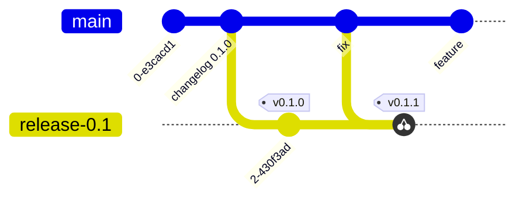

# Development

How to work on provider-aws-v2: setup, the workflow for kinds, conventions
and what "done" means. The design behind it is in
[architecture.md](architecture.md); how one kind's code fits together is in
[anatomy-of-a-kind.md](anatomy-of-a-kind.md).

## Setup

- Go (the version in `go.mod`; `make` downloads it), Docker for images,
  `kind`/`kubectl` for `make dev` (downloaded by the build submodule).
- `make submodules` once.
- For imports: a checkout of
  [provider-aws](https://github.com/crossplane-contrib/provider-aws) next to
  this repository (`../provider-aws`).
- AWS API models are downloaded on first generation and cached.

Before changing a kind, read its `README.md` in
`internal/controller/<svc>/<kind>/`.

## Workflows

| Task | Guide |
|------|-------|
| Port a kind that exists in provider-aws | [`import-kind` skill](../.agents/skills/import-kind/SKILL.md) |
| Add a kind or service that doesn't exist there | [`add-service` skill](../.agents/skills/add-service/SKILL.md) |
| Change behavior of an existing kind | below |
| Update the AWS SDK / API model of a service | below |
| Change the generator or templates | [code-generator.md](components/code-generator.md) |

The skills are written as step-by-step instructions that both people and
coding agents follow.

### Changing a kind

1. Read the kind README and its tests.
2. Change only hand-written files (`setup.go`, `custom_types.go`, helpers).
   If a hook or generated function is missing, change the template and
   regenerate all services.
3. Prefer generated behavior: drift detection builds on
   `DiffUpdatableParameters`; field mapping comes from `Generate<Op>Input`.
   Hand-written code covers only what generation can't know.
4. Add a test for the behavior, ideally in the order the reconciler calls
   the hooks ([crossplane-runtime.md](components/crossplane-runtime.md#one-reconcile)).
5. Update the kind README (behavior, limitations, history row) and
   `CHANGELOG.md`.

### Updating a service's AWS SDK

1. Bump `github.com/aws/aws-sdk-go-v2/service/<svc>` (Renovate does this).
2. `make services SERVICES=<svc>` → `make generate` → build and test.
3. Review the diff of `zz_*` types and CRDs: new fields are new API surface.
   New updatable fields are compared automatically; check whether they need
   late initialization or special handling, and note them in the changelog.

## Conventions

- **Generated vs. hand-written**: never edit `zz_*`, `package/crds`,
  `build/`. Fix the generator or importer instead of patching output.
- **Namespaces**: secret refs are local and read in `mr.GetNamespace()`;
  nothing is read from other namespaces
  ([ADR 0002](adr/0002-namespaced-resources-only.md)).
- **Types**: API types are ACK-style (`*int64`, `[]*string`); convert with
  `internal/utils/pointer` and `aws.ToStringSlice`.
- **Errors**: wrap with `crossplane-runtime/v2/pkg/errors`; AWS errors with
  `awsclient.Wrap`.
- **Conditions**: set `Available`/`Unavailable` in `postObserve` from the AWS
  status; the generated controller doesn't.
- **License header** on every Go file
  (`codegen/templates/boilerplate.go.tpl`).
- **Commits**: subject scoped by area, imperative, ≤ 72 chars:
  `docdb/dbcluster: compare all updatable fields`, `codegen: …`,
  `importer: …`, `docs: …`. Body explains why. Sign off (`git commit -s`,
  [DCO](../DCO)). One logical change per commit; generated files go in the
  same commit as their cause.

## Documentation

Docs are part of the change, in the same commit:

| You change… | Update |
|-------------|--------|
| Behavior of a kind | its `README.md` (history row) and `CHANGELOG.md` |
| User-visible API (fields, defaults, examples) | `CHANGELOG.md`, `examples/` |
| A component (generator, importer, runtime use, auth) | its page in `docs/components/` |
| A decision of the kind recorded in `docs/adr/` | a new ADR |
| A porting pitfall | `docs/porting-notes.md` |
| Workflow, layout, commands | `AGENTS.md`, the skills |

Write for a developer new to the repository: say what and why before how,
link instead of repeating, prefer a table or diagram over a long paragraph.

### Kind README

Each kind has `internal/controller/<svc>/<kind>/README.md` with these
sections ([ADR 0008](adr/0008-kind-readme-and-changelog.md)):

```markdown
# <svc>/<Kind>

One sentence: what AWS resource this manages.

## Origin
Imported from provider-aws <repository>@<commit> (see apis/<svc>/import.yaml)
| or generated from scratch on <date>.

## Behavior
External name, create/restore paths, how drift is detected, connection
details, conditions. Table of hand-written hooks and why they exist.

## Differences from provider-aws        (imported kinds only)

## Limitations
Fields AWS can't change after creation, unsupported features, known issues.

## Examples
Links to examples/<svc>/.

## History
| Date | Commit | Change |
```

Rows in "History" are behavior changes, newest first; refactorings without
behavior change don't need a row.

## Releasing

Provider versions are [SemVer](https://semver.org/) git tags `vX.Y.Z`
([ADR 0010](adr/0010-release-branches-and-tags.md)). They version the
package: binary, behavior, flags. Each kind's schema has its own API version
(`v1alpha1`, …) with the
[Kubernetes rules](https://kubernetes.io/docs/reference/using-api/#api-versioning):

| API version | Changes allowed in a provider release |
|-------------|---------------------------------------|
| `v1alpha1` (all kinds today) | Incompatible changes in a minor release, with migration notes in `CHANGELOG.md` |
| `v1beta1` and later | Compatible changes only; an incompatible one needs a new API version |

Patch releases have no incompatible changes.



| Branch | What lands there |
|--------|------------------|
| `main` | All development, through pull requests with green CI |
| `release-X.Y` | Cut from `main` for each minor release; only backported fixes |

### Minor release (`vX.Y.0`)

1. PR to `main`: in `CHANGELOG.md`, rename "Unreleased" to
   `## [X.Y.0] - <date>` and add its link at the bottom. The next change
   after the release starts a new "Unreleased" section.
2. After merge, with CI green on that commit, cut the branch:
   `git switch -c release-X.Y origin/main && git push origin release-X.Y`.
3. Tag the branch head: run the **Tag** workflow (Actions → Tag, branch
   `release-X.Y`, version `vX.Y.0`), or
   `git tag -s -a vX.Y.0 -m vX.Y.0 && git push origin vX.Y.0`.
4. Create the GitHub release from the tag with the changelog section as
   notes: `gh release create vX.Y.0 --verify-tag --title vX.Y.0 --notes-file <section.md>`.
5. Build the package from the tag and push it to your registry
   ([README](../README.md#installing)). GitHub CI doesn't publish images yet.

### Patch release (`vX.Y.Z`)

1. Fix on `main` first (PR with a changelog entry under "Unreleased").
2. Backport: label the PR `backport release-X.Y` before merging, or comment
   `/backport release-X.Y` afterwards; a bot opens the backport PR.
   Fixes that only apply to the old version go to `release-X.Y` directly.
3. PR to `release-X.Y`: move the backported entries to
   `## [X.Y.Z] - <date>`; then tag `vX.Y.Z` on `release-X.Y` and create the
   GitHub release as above.
4. PR to `main` that adds the same `[X.Y.Z]` section, so `main`'s changelog
   lists every release.

## Definition of done

- [ ] `make services` and `make generate` produce no diff.
- [ ] `go build ./... && go vet ./...`, `make test` and `make lint` pass
      (both cover the `codegen/` module; `golangci-lint fmt ./...` fixes
      import grouping).
- [ ] No `*_importtodo.go` files, no `TODO(import)`.
- [ ] Tests cover the new behavior (including the "not called" case for
      AWS operations where it matters).
- [ ] Examples apply against the CRDs (`--dry-run=server --validate=strict`).
- [ ] AWS-dependent changes validated against live AWS (checklist in
      `.github/PULL_REQUEST_TEMPLATE.md`, how-to in
      [testing.md](components/testing.md#manual-validation-against-aws)).
- [ ] Kind README, `CHANGELOG.md` and affected docs updated.
